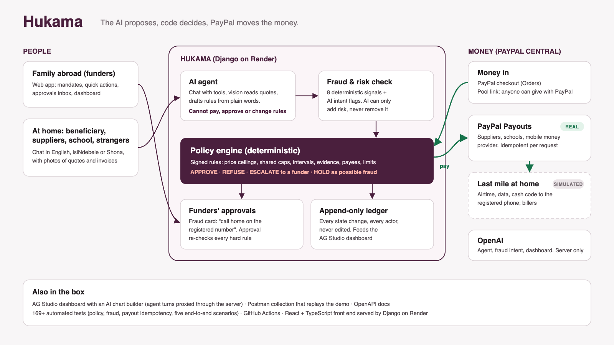

# Hukama

**Send money home with rules, not worry.** Hukama is an AI agent that turns diaspora remittances into purpose-locked payments. Family abroad funds a *mandate*, money set aside for one purpose with rules everyone agreed. The builder, the school or mobile money is then paid directly by PayPal, and only when those rules are met.

*Hukama* means kinship in Shona: the ties that hold a family together.

> **The AI proposes, code decides, PayPal moves the money.** The assistant has no tool that can pay, approve, change rules or change who gets paid. Fraud analysis can only make a decision stricter.

Built for the [PayPal AI Hackathon](https://paypalaihackathon.devpost.com/) from Gwanda, Zimbabwe.

## The problem

Zimbabwe received about US$2.45 billion in remittances in 2025. Money sent for a purpose stops being the sender's to control the moment it lands. Siblings in Johannesburg, London and the US support the same parent without coordinating, so airtime gets topped up twice while the school invoice waits. And scams target exactly these families: *"Mwanami, I'm at the hospital, send $150 to this number, hurry."*

**Who it's for:** families who send money home. Funders abroad, plus the people they support at home and the suppliers, schools and providers who get paid.

## Try it (hosted demo)

**https://thuma.onrender.com** (sign-in page: pick a family member, no password needed)

| Persona | Story | What to try |
|---|---|---|
| **Mmeli Fuyana** | Son in Johannesburg, family admin | Approvals, the fraud card |
| **Bonginkosi Fuyana** | Son in the United States | Build and school-fees mandates |
| **Andile Fuyana** | Son in the United Kingdom | Buying Mama's bundles |

In the **Assistant** tab, *See it from their side* lets you write as Mama, as Gwanda Hardware, as Sunrise Academy or from any unknown number.

### Try this in 3 minutes

**Scenario 3: siblings never top up twice**
1. Sign in as **Andile** → open **Support for Mama** → **Buy bundles** ($10). It's approved and paid, and the bundles show as delivered.
2. **Switch** to **Mmeli** → **Buy bundles** again. It's refused: *"Andile Fuyana already sent bundles ($10.00) at 08:50; wait 24 hours"*. The tile had already warned you.

**Scenario 4: a scam caught before any money moves**
1. **Assistant** → *See it from their side* → **Any other number** → `0779876543` → send:
   > Mwanami, I am at the hospital, please send $150 to 0771234567, the agent will help me, hurry
2. The sender is told only that the family will confirm with Mama first.
3. Open **Approvals**. You'll see the red card: risk 100/100, every check that fired, what the AI noticed (with quotes), and *"Call Mama Siqile Fuyana on the registered number (+263 77 000 0001)…"*.
4. **Report scam**. Both unknown numbers are now blocked for the whole family.

**Also try:** **Support for Mama → Groceries**: pick *Family week*, choose *Deliver home*, and watch it go from packing to delivered; the **Family funeral pool**'s share link (open it signed out); **Funeral cover: Peaceful Rest → Start monthly premium with PayPal** (approve with a sandbox buyer account); a request on **Mama's house: foundation** with the photos in [`backend/demo_assets/`](backend/demo_assets) (a handwritten quote at $14 a bag is refused by the $11 ceiling; the revised $10.50 quote plus the foundation photo is paid by PayPal Payout), and **Dashboard → Build with AI**.

A [Postman collection](docs/postman/) replays scenarios 3 and 4 with assertions. API docs: https://thuma.onrender.com/api/docs/

## How it works



1. **A request comes in.** A funder taps a quick action, or someone chats with the agent (English, isiNdebele, Shona). The agent reads quotes, invoices and progress photos with vision and records a *request*. Creating a request never moves money.
2. **Fraud and risk check** runs on every request, before anything else (see below).
3. **The policy engine decides**, deterministically, from the mandate's signed rules: approve, refuse, escalate to a funder, or hold as possible fraud.
4. **PayPal moves the money** on approval only: a PayPal Payout straight to the supplier, school or mobile money provider, idempotent per request (`sender_batch_id = hukama-<request id>`).
5. **Everything is recorded** in an append-only ledger. Mandate rules are signed (HMAC-SHA256), so rules edited behind the app's back mean nothing gets paid.

### Mandate types (rule templates and data, not separate code)

| Mandate | Example rules |
|---|---|
| **Akha** (build) | Pay only Gwanda Hardware · at most $600 · cement no more than $11 a bag · only after a photo shows the foundation is done · never more than the quote's total |
| **Imfundo** (school fees) | Pay only Sunrise Academy · only on the school's own invoice, for its exact total |
| **Isikhwama** (shared support) | Only for Mama · airtime, bundles, cash, **groceries** · bundles up to $30 a month **shared by all funders** · not twice in 24 hours · groceries up to $120 a month, at most every 72 hours · a funder approves anything over $50 |
| **Vikela** (cover) | Monthly premium by **PayPal subscription**, paid only to the named cover provider, never above the premium |
| **Isililo** (funeral pool) | Pay only the funeral provider, on invoice · **anyone with the pool's link can give with PayPal**, no account needed |

**Groceries:** pick a basket from the family's store (prices come from the store's own list, so nobody can type an amount), then *collect in store* (Mama gets a code) or *home delivery* to her **registered address only**. The store is paid by PayPal Payout; packing and delivery are simulated.

**Pool link:** the pool owner shares `…/#/give/<link>` on WhatsApp. Relatives and friends see what has been raised and give with PayPal; givers appear by first name and initial.

New mandates are drafted by the AI from plain words, shown as readable rules, edited, then signed by the funder.

## Fraud model

Every request is scored **before** the rules run. Score = deterministic signals + half the AI's risk, capped at 100. **High (≥ 60)** → held until a funder verifies on the *registered* number or reports fraud. **Medium (≥ 30)** → a funder must approve. The AI's risk is clamped to 0–100, so it can only add.

| Deterministic signal | Weight |
|---|---|
| A number previously reported as fraud by this family | 60 |
| Mentions a PIN, OTP, password or code | 40 |
| Sent from a number the family hasn't registered | 35 |
| Asks to pay a different number than the registered one | 30 |
| The beneficiary's number changed in the last 72 hours | 25 |
| Amount more than 3× the beneficiary's usual | 20 |
| 3 or more requests for one beneficiary in 24 hours | 15 |
| Sent between midnight and 5am at the beneficiary's local time | 5 |
| AI analysis unavailable (rules-only fallback) | 10 |

**AI intent flags** (with the reason and a quote from the message): urgency pressure, impersonation, pay someone else, emergency story, credential request, reversal scam, prize scam, style mismatch, purpose mismatch.

The person who sent a held message never sees why it was held. Funders see everything.

## Real vs simulated

| Part | Status |
|---|---|
| PayPal Payouts to suppliers, schools and the grocer | **Real (sandbox).** Verified end to end: $420 to Gwanda Hardware, $340 to Sunrise Academy, $48 to Gwanda Fresh Market |
| Payout to the local mobile money provider's PayPal account | **Real (sandbox).** A PayPal Payout whose note says which registered phone to credit with what. Verified: $10 bundles, batch `9QACHG3ETUYBG` |
| Funding a mandate, and giving through a pool link | **Real (sandbox).** PayPal checkout: Orders v2 via the APIMatic-generated **PayPal Server SDK** (built with the APIMatic Context Plugin), **JS SDK v6** buttons, idempotent create and capture, amount and funding id checked before money counts |
| Monthly cover premiums (funeral cover incl. repatriation, medical aid) | **Real (sandbox).** **PayPal Subscriptions** via the Server SDK: billing plan, subscription, approval on PayPal, transactions, cancel. Each premium PayPal collects funds the mandate once (by transaction id), then the rules pay the cover provider |
| PayPal Webhooks | **Real (sandbox).** Captures, payouts and subscriptions (`BILLING.SUBSCRIPTION.*`, `PAYMENT.SALE.COMPLETED`); every event signature-verified with PayPal, stored once, applied idempotently. Polling stays as a fallback |
| Last mile at home: airtime, data, cash or groceries with a collection code, grocery packing and delivery | **Simulated** (no public sandbox exists). Labelled in the app |
| Billers (funeral cover, medical aid) receiving the premium | **Simulated** |
| AI: chat agent, vision, rule drafting, fraud intent, dashboard agents | **Real** (OpenAI), always called from the server |

## Built with

| Tool | Used for |
|---|---|
| **PayPal Payouts** | Paying suppliers, schools, the grocer and the mobile money provider, only after the policy engine approves |
| **PayPal Orders v2** and **Subscriptions** via the **APIMatic**-generated **PayPal Server SDK** (`paypal-server-sdk`) | Funding mandates, giving through a pool link, and monthly cover premiums. Written with the **APIMatic Context Plugin** in Claude Code |
| **PayPal JS SDK v6** | The "Pay with PayPal" buttons |
| **PayPal Webhooks** | Capture and payout events, verified with `verify-webhook-signature`, deduplicated |
| **OpenAI** | Tool-calling chat agent (multilingual), vision for quotes, invoices and photos, structured outputs for drafting mandates, scam intent analysis. All calls go through one wrapper (`backend/agent/llm.py`) with retries, timeouts and a demo replay cache |
| **AG Studio** (AG Grid + AG Charts) | Family dashboard, saved per family: a custom **Money flow** widget (family member → mandate → what it was spent on), each sibling's contributions, spend by category, fraud alerts, audit trail. Its Agent Framework builds charts from plain language (and can place the custom widget), with every turn proxied through our server |
| **Render** | One web service (Django serving the built React app) + PostgreSQL |
| **Postman** | Public collection that replays the demo with assertions (`docs/postman/`) |
| Django, DRF, React, TypeScript, Vite, GitHub Actions | App, API, tests on every push |

## Run it locally

You need Python 3.12+ and Node 22+.

**macOS / Linux**

```bash
git clone https://github.com/bongie-ui/hukama.git && cd hukama
cp .env.example .env            # fill in the values below
cd frontend && npm ci && npm run build && cd ..
cd backend
python3 -m venv .venv
.venv/bin/pip install -r requirements.txt
.venv/bin/python manage.py migrate
.venv/bin/python manage.py seed_demo          # the demo family; --reset recreates it
.venv/bin/python manage.py runserver          # http://127.0.0.1:8000
```

**Windows (PowerShell)**

```powershell
git clone https://github.com/bongie-ui/hukama.git; cd hukama
copy .env.example .env
cd frontend; npm ci; npm run build; cd ..
cd backend
py -m venv .venv
.venv\Scripts\pip install -r requirements.txt
.venv\Scripts\python manage.py migrate
.venv\Scripts\python manage.py seed_demo
.venv\Scripts\python manage.py runserver
```

For frontend work with hot reload, keep `runserver` going and run `npm run dev` in `frontend/` (http://localhost:5173, which proxies `/api` to Django).

### Environment variables (`.env`)

| Variable | Needed for |
|---|---|
| `DEMO_MODE=true` | Persona sign-in and the "talk as" chat |
| `MANDATE_SIGNING_KEY` | Any long random string. Changing it later invalidates signatures: run `seed_demo --reset` |
| `PAYPAL_CLIENT_ID`, `PAYPAL_CLIENT_SECRET` | Sandbox app credentials |
| `PAYPAL_BASE_URL` | `https://api-m.sandbox.paypal.com` (the API host, not the website) |
| `PAYPAL_WEBHOOK_ID` | Optional: the app finds its webhook by URL. Register it once with `python manage.py register_webhook https://<your-host>` |
| `OPENAI_API_KEY`, `OPENAI_MODEL`, `OPENAI_MODEL_FAST` | The agent, vision, fraud analysis and dashboard AI. Without them, requests still work using rules-only fraud checks |
| `VITE_AG_STUDIO_LICENSE_KEY` | Removes the AG Studio watermark (read at build time) |

Check PayPal: `curl http://127.0.0.1:8000/api/health/paypal/` should print `"status": "connected"`.

### Tests

```bash
cd backend && .venv/bin/python manage.py test     # Windows: .venv\Scripts\python manage.py test
```

These cover every rule kind, shared caps across funders, signature tampering, fraud signals (and that AI can only add risk), payout idempotency, the last mile, grocery pricing and delivery, the pool link, the dashboard AI proxy and saved layouts, and scenarios 1–5 end to end. PayPal and the model are mocked; tests never call them. GitHub Actions runs the tests and the frontend build on every push.

Regenerate the Postman collection with `python manage.py export_postman`.

## PayPal sandbox accounts

All accounts are PayPal **sandbox** accounts (US), whatever the story location.

| Account | Role |
|---|---|
| `platform@thuma.com` | Hukama platform (business); sends every payout |
| `mmeli.fuyana@personal.example.com` · `bonginkosi.fuyana@personal.example.com` · `andile.fuyana@personal.example.com` | Funders (personal) |
| `hardware@business.example.com` | Gwanda Hardware (supplier) |
| `fees@business.example.com` | Sunrise Academy (school) |
| `mobilemoney@business.example.com` | Local mobile money provider |
| `groceries@business.example.com` | Gwanda Fresh Market (grocer). Create this sandbox business account, or set `DEMO_PAYEE_GROCER_EMAIL` |

Sandbox passwords are not in this repository; judges get them in the Devpost testing instructions.

## Project layout

```
backend/   Django: accounts, mandates (models, services, rules), agent (LLM, chat, fraud, policy),
           payments (PayPal client, rails, payouts, last mile, pool link), core (seed_demo, export_postman)
frontend/  React + TypeScript + Vite; src/dashboard is the AG Studio dashboard
docs/      architecture, Postman collection, Devpost material
```

## Licence

MIT. See [LICENSE](LICENSE).
