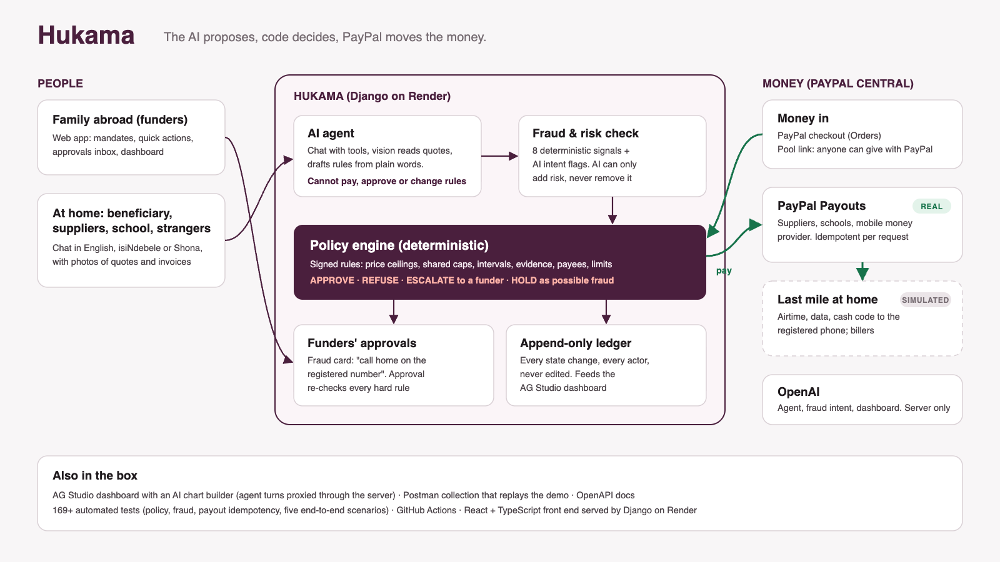

# Hukama: guide for judges and testers

**Live app:** https://thuma.onrender.com · **Code:** https://github.com/bongie-ui/hukama · **API (Postman):** https://documenter.getpostman.com/view/43618475/2sBYHXRJVS · **API docs:** https://thuma.onrender.com/api/docs/

Everything runs on PayPal's **sandbox**: no real money moves. The Fuyana family in the demo is fictional; the problem it illustrates is real.

---

## 1. What Hukama is, in one minute

People who live abroad send money home for a purpose: school fees, building a house, a parent's groceries, a funeral. Once the money lands, nobody can see whether it went to that purpose, siblings top up the same thing twice, and scammers impersonate family ("I'm at the hospital, send $150 to this number").

Hukama attaches **rules** to the money:

1. Family abroad create a **mandate**: money for one purpose with rules everyone signs (who may be paid, price limits, monthly limits, evidence needed).
2. They **fund** it with PayPal.
3. **Requests** come in from the family, from the person at home, or from the school or supplier. The **AI** reads the message and any quote, invoice or photo, and checks for **fraud**.
4. A deterministic **rules engine** decides: pay, refuse with the reason, ask a funder, or hold as possible fraud.
5. **PayPal pays** the school, supplier, shop or mobile money provider **directly**. Nobody in the middle holds cash.

> **The AI proposes, code decides, PayPal moves the money.** The assistant has no tool that can pay, approve, change rules or change who gets paid. Fraud analysis can only make a decision stricter.

---

## 2. The demo family

| Person | Role | What to try as them |
|---|---|---|
| **Mmeli Fuyana** | Son in Johannesburg, family admin | Approvals, People (links, PINs, invites) |
| **Bonginkosi Fuyana** | Son in the United States | Build and school-fees mandates, funeral cover |
| **Andile Fuyana** | Son in the United Kingdom | Buying their mother's bundles and groceries |
| **Mama Siqile Fuyana** | Mother at home in Gwanda (no PayPal) | Her own shop link, opened with a PIN |

Sign in at https://thuma.onrender.com by choosing a family member (no password in the demo). "Switch" changes person.

### The mandates

| Mandate | Rules |
|---|---|
| **Mama's house: foundation** (build) | Pay only Gwanda Hardware · at most $600 · cement no more than $11 a bag · only after a photo shows the foundation is done · never more than the quote's total |
| **School fees: Sunrise Academy** | Pay only the school · only on its own invoice, for its exact total |
| **Support for Mama** (shared) | Airtime, bundles, cash, groceries · monthly limits shared by all three sons · no double top-ups (24 h for bundles, 72 h for groceries) · a son approves anything over $50 |
| **Family funeral pool** | Pay only the funeral provider, on invoice · anyone with the pool's link can give with PayPal |
| **Funeral cover: Peaceful Rest** | Monthly premium by PayPal Subscriptions, paid only to the cover provider |

---

## 3. Try it: ten-minute tour

**A. Siblings never top up twice**
1. Sign in as **Andile** → **Support for Mama** → **Buy bundles** ($10). Approved, paid, delivered.
2. **Switch** to **Mmeli** → **Buy bundles**. Refused: *"Andile Fuyana already sent bundles… wait 24 hours"*.

**B. A scam caught before any money moves**
1. **Assistant** → *See it from their side* → **Any other number** → `0779876543` → send: *Mwanami, I am at the hospital, please send $150 to 0771234567, the agent will help me, hurry*.
2. The sender is told only that the family will confirm first.
3. **Approvals** shows the red card: risk 100/100, every signal, what the AI noticed, and *"Call Mama… on the registered number"*. **Report scam** blocks both numbers for the family.

**C. A quote checked against the rules**
1. **Mama's house: foundation** → **Request a payment** → attach [`quote_cement_14.jpg`](../backend/demo_assets/quote_cement_14.jpg), amount $560 → refused by the $11 price ceiling and the missing photo.
2. Again with [`quote_cement_10_50.jpg`](../backend/demo_assets/quote_cement_10_50.jpg) and [`foundation_slab.jpg`](../backend/demo_assets/foundation_slab.jpg), amount $420 → approved and paid to Gwanda Hardware by PayPal Payout.

**D. Ways in without an account (the home page)**
- **Send an invoice** (schools and businesses): sign out, choose **Send an invoice**, and log in with PayPal as `fees@business.example.com`. Hukama recognises Sunrise Academy and lists the families it can invoice; **Send** opens its upload page already logged in. Any other PayPal account is turned away.
- **Shop with your PIN** (family at home): your registered phone number and the PIN the family told you open your shop.
- **Ask Hukama**: a guide on every public page that answers questions. It can't see any family's money.

**E. The supplier sends its own quote (no Hukama account, but proof of who it is)**
1. On **Mama's house: foundation**, **Let Gwanda Hardware send it themselves** → copy the upload link and open it in a private window.
2. **Log in with PayPal** as the sandbox account `hardware@business.example.com` (password in the judges' notes on Devpost). Any other PayPal account is turned away.
3. Send a photo of a quote with the amount. It becomes a request that can only pay Gwanda Hardware and goes through the same checks.

**F. Mama shops for herself**
1. As **Mmeli**: **People** → Mama → **Shop link** → **New PIN** (shown once; in real life you tell her by phone).
2. Open the link in a private window, enter the PIN, add items, choose collect or delivery, and who to ask if the fund is short.
3. The support fund pays when the rules allow, and every son is notified. If the fund were short, the list would go to every son (or the one she picked); the first to pay with PayPal covers it and the others are told.
4. Five wrong PINs turn the link off and alert the family.

**G. Fund with PayPal**
On any mandate, enter an amount → **Pay with PayPal** → log in as a funder's sandbox account (below) → approve. The money counts only once PayPal confirms the capture.

**H. More**
- **Funeral cover: Peaceful Rest** → **Start monthly premium with PayPal** (approve with a funder's sandbox account).
- **Family funeral pool** → share link → open it signed out and give with PayPal.
- **Dashboard** → **Build with AI** → *"chart cash paid out per month"*.
- Sign out → **Start your family**: a new family gets a short tour and a "Getting started" checklist.

---

## 4. Sandbox PayPal accounts

All are PayPal **sandbox** accounts (US, test money only). **Passwords are in the judges' testing notes on Devpost**, not in this public page, so nobody can lock the demo accounts.

| Account | Who it is in the demo | Use it to |
|---|---|---|
| `mmeli.fuyana@personal.example.com` | Mmeli (funder) | Approve PayPal checkout when funding, paying a shopping list or starting a premium |
| `bonginkosi.fuyana@personal.example.com` | Bonginkosi (funder) | Same |
| `andile.fuyana@personal.example.com` | Andile (funder) | Same |
| `hardware@business.example.com` | Gwanda Hardware (supplier) | Log in with PayPal on its upload link; see payouts arrive on sandbox.paypal.com |
| `fees@business.example.com` | Sunrise Academy (school) | **Send an invoice** on the home page, or Log in with PayPal on its upload link; see the $340 fee payouts |
| `mobilemoney@business.example.com` | Local mobile money provider | See airtime, bundles and cash payouts (with the phone to credit in the note) |

Payouts are sent by the platform's own sandbox business account, which is not shared.

---

## 5. How it works

| Part | What happens |
|---|---|
| **Fraud check** (every request, first) | Fixed signals (unregistered sender, a different number in the message, number or address recently changed, amount spike, velocity, odd hours, PIN/OTP mentioned, a number reported before) plus an AI read of intent (urgency, impersonation, pay someone else, emergency story). High risk → held until a funder calls the registered number. The AI can only add risk |
| **Rules engine** | Deterministic checks of the signed rules: payee, product, price ceiling, per-request and monthly limits, minimum interval, evidence, invoice total, approval limit, balance. Decisions on one mandate are serialised so two siblings can't spend the same limit at once |
| **PayPal in** | Orders v2 via the APIMatic-generated PayPal Server SDK + JS SDK v6 buttons; Subscriptions for premiums; captures counted only when COMPLETED for the exact amount |
| **PayPal out** | Payouts, idempotent per request (`sender_batch_id = hukama-<request id>`); only verified payees; status only moves forward |
| **Webhooks** | Signature-verified, stored and applied once: captures, refunds and chargebacks, payouts, subscriptions |
| **Links without accounts** | Upload link (Log in with PayPal as the payee's own account), shop link (PIN told by phone), pool link (give with PayPal) |
| **Audit** | Every state change is an append-only ledger entry; mandate rules are signed (HMAC-SHA256) |

**Real vs simulated:** all PayPal flows are real sandbox calls. The last mile at home (airtime, data, cash pickup, grocery packing and delivery) and the cover billers are **simulated** and labelled in the app, because no public sandbox exists for them.

---

## 6. Why it matters (real figures)

- Zimbabwe received about **US$2.45 billion** in diaspora remittances in 2025, up about 14% on 2024 and more than 8% of GDP; the UK and South Africa are the largest sources ([The Zimbabwe Mail](https://thezimbabwemail.com/main-headline/zimbabwes-diaspora-remittances-rise-to-us2-45-billion-as-uk-overtakes-south-africa/), [FurtherAfrica](https://furtherafrica.com/2026/02/02/zimbabwe-remittances-rise-fx-stability-2025/)).
- January to August 2026: about **US$1.86 billion**, up 22% on the same months of 2025 ([The Herald](https://www.heraldonline.co.zw/diaspora-remittances-surge-22pc/)).
- Sending money to Sub-Saharan Africa costs about **8.5–9%** on average, the most of any region, against a global average near 6.4% and a UN target of 3% ([UN DESA, Nov 2025](https://policy.desa.un.org/publications/world-economic-situation-and-prospects-november-2025-briefing-no-196)).

---

## 7. Run it yourself

See the [README](../README.md#run-it-locally): clone, `cp .env.example .env`, build the frontend, `migrate`, `seed_demo`, `runserver`. 276 automated tests run on every push (GitHub Actions, PostgreSQL).
